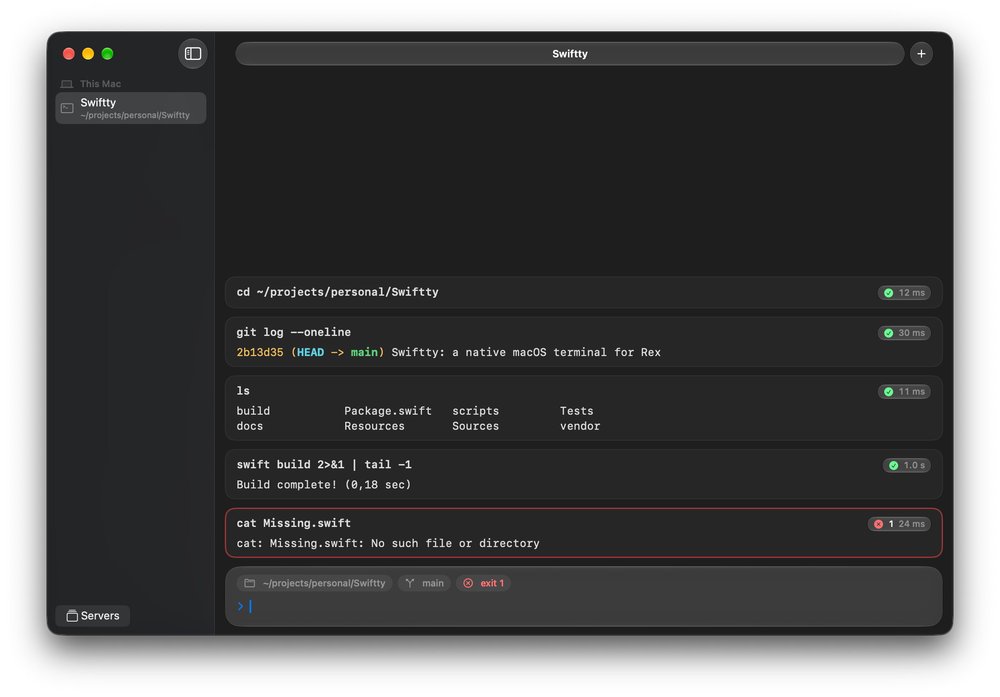

  

<h1 align="center">Swiftty</h1>

  <b>A native Mac terminal with a real text-field prompt and command blocks.</b> 
  Built in Swift with native macOS controls and Liquid Glass, running your shells through <a href="https://www.superlogical.com/rex/docs">Rex</a>.

  <a href="https://github.com/HonzaKubita/Swiftty/releases/latest"><b>Download the latest release</b></a>

  

## Features

- **A prompt that edits like a Mac.** The command line is a real macOS text field: select with the mouse, ⌥/⌘-arrow navigation, undo, Look Up, and dictation all work as they do everywhere else.
- **Command blocks.** Every command becomes its own card with its exit status and how long it took. Output is native, selectable text you can copy, drag, or search, and failed commands are outlined in red.
- **Completions as you type.** After a command, matching files and folders appear right away. <kbd>Tab</kbd> moves through them, <kbd>Return</kbd> uses one, and <kbd>Return</kbd> with nothing picked runs the command. Grey inline suggestions come from your history; <kbd>→</kbd> accepts them.
- **Fast, faithful terminal.** Full-screen programs like `vim`, `htop`, and `less` get a GPU-drawn terminal powered by Ghostty's terminal engine.
- **Local and remote in one window.** Put tabs on this Mac and on a Linux server side by side. The sidebar groups them by machine.
- **Sessions that survive.** Rex keeps your shells running, so quitting Swiftty, or losing your connection, doesn't end them. Your blocks come back when you return.
- **Quick Terminal.** Press a global hotkey from any app for a full-screen terminal on the display under your pointer. It's always the same session. Swiftty can even stay out of the Dock when no other window is open.
- **Safari-style tabs** in the toolbar, rename any tab with a double-click.

## Requirements

- macOS 27 or later on a Mac with Apple silicon.
- **[Rex](https://www.superlogical.com/rex/docs)** — Swiftty is a client for Rex, which runs and keeps your shells. Install Rex to use Swiftty on this Mac.
  No Rex on this Mac? You can still use Swiftty to connect to Rex running on another machine.
- For the native prompt and command blocks: **zsh** (the macOS default) or **bash 4.4+**. Other shells work as a regular terminal.

## Install

1. Download the zip from the [latest release](https://github.com/HonzaKubita/Swiftty/releases/latest) and unzip it.
2. Move **Swiftty** to your Applications folder and open it.

Swiftty is signed and notarized by Apple, so it opens without warnings. On first launch it checks whether Rex is installed and walks you through getting started.

### Updates

Swiftty keeps itself up to date: it checks for new versions automatically and installs them for you. You can also choose **Swiftty → Check for Updates…**, or change how updates work in **Settings → General**.

## Using Swiftty

### Shortcuts

| Shortcut | Action |
| --- | --- |
| <kbd>⌘</kbd> <kbd>T</kbd> | New tab |
| <kbd>⌘</kbd> <kbd>W</kbd> | Close tab |
| <kbd>⌘</kbd> <kbd>N</kbd> | New window |
| <kbd>⌘</kbd> <kbd>1</kbd> … <kbd>9</kbd> | Go to tab |
| <kbd>⇧</kbd> <kbd>⌘</kbd> <kbd>[</kbd> / <kbd>]</kbd> | Previous / next tab |
| <kbd>⌘</kbd> <kbd>K</kbd> | Clear the blocks |
| <kbd>⌃</kbd> <kbd>C</kbd> | Stop the running command (or clear the prompt) |
| <kbd>⌃</kbd> <kbd>\`</kbd> | Quick Terminal (change it in Settings) |
| <kbd>⌘</kbd> <kbd>,</kbd> | Settings |

In the prompt, <kbd>⇧</kbd> <kbd>Return</kbd> adds a new line, <kbd>↑</kbd> / <kbd>↓</kbd> browse your history, and <kbd>Esc</kbd> hides the completions.

### Remote servers

Open the **Servers** menu at the bottom of the sidebar and choose **Add Server…**, then enter one of:

- `ssh://you@devbox` — connects over ssh with your ssh keys and `~/.ssh/config`. Rex must be installed on that machine.
- `devbox.your-tailnet.ts.net` or `host:7297` — connects straight to a Rex server that listens on the network.

Then add a tab on that server from the Servers menu, or with the **+** next to its name in the sidebar. Servers you add also show up in `rex hosts`, and hosts you add there show up in Swiftty.

### Sessions

Each window holds one Rex session per machine it has tabs on. Closing a window keeps its sessions running — reopen them from **Servers → Open Session in New Window**. To end a session and all of its tabs, hover its name in the sidebar and click **✕**.

### Shell integration

To draw its prompt and blocks, Swiftty starts your shell with a small integration script. It's written to `~/.cache/swiftty/shell` on the machine the shell runs on and loads your usual `.zshrc` / `.bashrc` first, so your setup keeps working. Your shell's own prompt is hidden while Swiftty's is shown.

## Plugins

Completions and the status pills above the prompt come from plugins: **Git** (current branch, branch and
remote completion), **Conda** (active environment, environment names for `conda`, `mamba` and `micromamba`),
and the basics. Switch them on and off in Settings › Plugins.

Want completions or a pill for your favourite tool? A plugin is one small Swift file:
see [PLUGINS.md](PLUGINS.md).

## License

Swiftty is available under the [MIT License](LICENSE).

## Acknowledgements

Swiftty is an independent project and isn't affiliated with Superlogical.

- [Rex](https://www.superlogical.com/rex/docs) by Superlogical runs the sessions.
- [Ghostty](https://ghostty.org)'s libghostty-vt is the terminal engine, and [Sparkle](https://sparkle-project.org) delivers updates. See [THIRD_PARTY_NOTICES.md](THIRD_PARTY_NOTICES.md).
